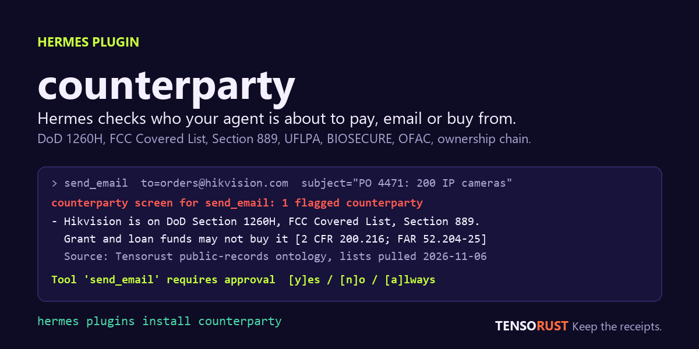

# counterparty

**Hermes checks who your agent is about to pay, email, sign with or buy from, before it does.**



Agents send purchase orders, pay invoices, place orders and sign things. None of them ask whether the company on the other side is on a federal banned-vendor list, who owns it, or whether it is under sanctions. This plugin makes Hermes ask, automatically, at the moment it matters, with the public record for every finding.

```
hermes plugins install counterparty
```

Until the catalog entry is merged, install from a clone (or from the repository with `--ref <the full commit SHA pinned in the catalog PR>`):

```
git clone https://github.com/Mattbusel/hermes-counterparty
hermes plugins install ./hermes-counterparty
```

Works out of the box. No account, no key. Python standard library only.

## What it does

**1. A gate in front of outward actions (`pre_tool_call`).** When the model is about to call a tool that sends email, pays, orders, transfers, signs or submits, the hook reads the counterparty out of the arguments (vendor and payee fields, the domain of an email address or URL, names in the subject or body) and screens it against:

| List | What it means for you | Rule |
|---|---|---|
| DoD Section 1260H Chinese military companies | procurement bans attach under later NDAAs | FY2021 NDAA sec. 1260H |
| FCC Covered List | no new equipment authorizations, no USF, E-Rate or RHC money | 47 U.S.C. 1601-1609; 47 CFR 1.50002 |
| Section 889 covered telecom and video surveillance | grant, cooperative agreement and loan funds may not buy it; contractors must report it | FAR 52.204-25; 2 CFR 200.216 |
| UFLPA Entity List | imports presumed made with forced labor, detainable at the border | Pub. L. 117-78; 19 U.S.C. 1307 |
| BIOSECURE biotechnology companies of concern | federal awards may not buy its equipment or services | FY2026 NDAA sec. 851 |
| OFAC sanctions (name match) | verify before any payment | 31 CFR chapter V |

plus the organization's public-record card: legal name, record sources (SEC, FCC licensing, USAspending, Form 5500, lobbying, FEC) and parent links.

On a hit, in the default `ask` mode, it returns Hermes's `approve` directive. Hermes shows its **own approval prompt** with the finding and the citation, and the human decides. The plugin never approves anything itself. Under cron, the gateway without a human, or any other unattended run, Hermes's gate fails closed and the call is refused with a clear message.

```
counterparty screen for send_email: 1 flagged counterparty
- hikvision: Hikvision (video surveillance) is on DoD Section 1260H Chinese military companies list,
  FCC Covered List, Section 889 covered telecom and video surveillance.
  Hikvision is covered telecom or video surveillance under Section 889. Grant, cooperative agreement
  and loan funds may not buy it (2 CFR 200.216), and federal contractors must report it
  (FAR 52.204-25). [Pub. L. 115-232 sec. 889(b)(1); 2 CFR 200.216; FAR 52.204-25]
Source: Tensorust public-records ontology, lists pulled 2026-11-06.

Tool 'send_email' requires approval   [y]es / [n]o / [a]lways / [s]ession
```

Clean counterparties pass with no prompt and no noise. Tools the gate does not watch (terminal, file edits, search) are never touched.

**2. A note when research turns up a listed vendor (`transform_tool_result`).** When a web search, page extract, browser read or file read mentions a listed vendor, the result gets a short appended note, once per vendor per session, so the agent learns about the problem while it is still comparing options rather than at checkout.

**3. Tools, for when the model or the user asks.**

| Tool | Answer |
|---|---|
| `cp_screen` | every list and sanctions hit for a name, with rule, severity, plain meaning and citation, plus the organization card |
| `cp_lookup` | who owns and controls a company: legal name, record sources, ownership chain followed upward, obligations |
| `cp_credit` | what private-credit lenders (BDCs) mark the company's first-lien loan at, from SEC filings: a stressed counterparty shows up here |
| `cp_who_owns_address` | owner of record for a US street address and the control group behind an entity owner |
| `cp_brief` | a one-page Markdown brief with a source line for every finding |

**4. `/whoowns <company or domain>` or `/whoowns <street address>, <zip>`** in any Hermes session or chat platform returns the brief. `/whoowns` alone shows what the gate did this session.

## Why a plugin and not a skill

A skill can tell the model to check. It cannot make the check happen when the model forgets, is rushed by a prompt injection, or is running a cron job at 3 AM with nobody watching. The `pre_tool_call` hook runs on every outward call whether or not the model thinks of it, and the escalation goes through Hermes's approval gate, which the model cannot skip.

## Settings

All under `plugins.entries.counterparty.settings` (or the Desktop settings form).

| Key | Default | Meaning |
|---|---|---|
| `mode` | `ask` | `ask` raises the approval prompt; `block` refuses the call with the finding; `warn` lets it through and appends the finding to the tool result; `off` disables the hooks, keeps the tools |
| `action_tools` | email, pay, order, purchase, invoice, transfer, sign, submit, vendor patterns | fnmatch patterns of tool names the gate watches |
| `watch_tools` | `web_search`, `web_extract`, `x_search`, `browser_*`, `read_file`, `*fetch*`, `*scrape*` | tool names whose results are scanned for listed vendors |
| `lists` | all six | subset of `1260H`, `FCC_COVERED`, `SEC889`, `UFLPA`, `BIOSECURE`, `OFAC` |
| `timeout_seconds` | `6` | per-request timeout for the API |
| `refresh_lists` | `true` | pull current list membership once a day (data only, in memory) |
| `tensorust_api_key` | unset | optional, env `TENSORUST_API_KEY`, read only through Hermes's secret scope; unlocks full rows |

Example `config.yaml`:

```yaml
plugins:
  entries:
    counterparty:
      enabled: true
      settings:
        mode: ask
        action_tools: ["send_email", "openmail_send", "laso_*", "zaprite_*", "*purchase*", "*order*"]
```

## Reliability

- **Offline is honest.** If the API does not answer inside the timeout, the hook screens against the bundled list snapshot (`data/lists.json`, with the pull date) and says so in the message. A clean name offline passes with the note that sanctions and ownership were not checked; a listed name offline still asks.
- **Bounded time.** The two API calls per name run in parallel under one budget (timeout + 2 s). Names per call are capped at three; free-text scanning is local and instant.
- **Never wedges the agent.** If the plugin itself errors, it logs and steps aside. Hermes's own approval gates are untouched either way.
- **One prompt per vendor.** The approve directive carries a `rule_key` per tool and vendor set, so the user's `[a]lways` applies to that vendor, not to every email.
- **Tests.** `pytest` runs 50 offline tests with a canned API (extraction, alias matching, the decision table for every mode, offline fallback, settings validation, manifest sync) and 3 live tests against the real API (a listed vendor, a clean public company, an FCC licensee with a parent). CI runs them on Python 3.11, 3.12 and 3.14 and runs `hermes plugins validate` against Hermes main.

## Disclosure

- **Network.** HTTPS POST to `https://shop.tensorust.com/api/mcp` only (JSON-RPC `tools/call`). Called from the hook when an outward tool call names a counterparty, from the tools and the slash command, and once a day to refresh list membership. Nothing else is contacted. Responses are cached in memory for 10 minutes.
- **What is sent.** The counterparty name, email domain or URL host taken from the tool call, plus the description, amount and date when given. The subject and body of an email are scanned locally and are not sent.
- **No telemetry, no shell, no background processes** other than one short daemon thread that refreshes list membership at startup. No files are read outside the plugin's own `data/`. No credential files, `.env`, `auth.json` or environment variables are read; the optional key comes from `agent.secret_scope.get_secret("TENSORUST_API_KEY")`.
- **No self-update.** `data/lists.json` is refreshed by a maintainer with `scripts/refresh_lists.py` and shipped in a reviewed commit. The daily runtime refresh changes list membership in memory only, never code or files.
- **Data and API.** The public-records ontology and the lists API are built and published by Tensorust LLC (Matthew Busel). Free tier answers are previews and are enough for everything the plugin does. Full rows need a key from https://shop.tensorust.com/ontology.
- **Limits.** The alias index covers the vendor groups the lists name and their named subsidiaries, not every shell company. A clear result means "not on these lists under this name," not legal advice. Address ownership covers a set of US counties and says when an address is outside it.

## Development

```
git clone https://github.com/mattbusel/hermes-counterparty
cd hermes-counterparty
python -m pytest tests      # offline tests
python -m pytest tests -m live -o addopts=""   # three live checks
hermes plugins validate .   # with a Hermes checkout on PATH
hermes plugins install /path/to/hermes-counterparty   # local install
```

AI tool disclosure: the code, tests and documentation in this repository were produced with Claude Code (Anthropic's coding agent) working under the direction of Matthew Busel, who chose the problem, the design and the data source (the Tensorust public-records ontology, which he built), and who reviewed and is responsible for the submission. Nothing here is copied from another plugin.

MIT License.
